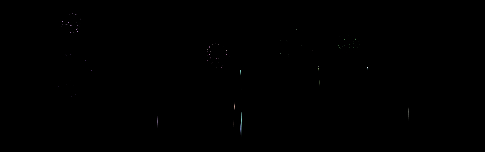

# Pong ScreenSaver
A Pong game screensaver for Windows

## 👤 Author

* [@remusrigo](https://github.com/RemusRigo)
* [@remusrigo](https://sourceforge.net/u/remusrigo/profile)

## ✨ Features

* Multi-Monitor support (including monitors with different scaling)
* Live preview in the Windows Screen Saver Settings dialog
* Settings: launch rate, burst size and particle life (stored per user in the registry)
* About box (right-click the Settings title bar)
* Builds for .NET Framework 4.8, .NET 8.0 and .NET 10.0 (x86 and x64)

## ⚙️ User's Guide

See the [User's Guide](Users%20Guide.md) for downloads, runtimes, installation and settings.

## 🛠️ Statistics

 
 

## 🗺️ Roadmap

* 2026-11-12: Fix: If ball is moving in a straigth horizontal line, it will get stuck there, so every time the ball touches the paddle it bounces off up or down (just a little)
* 2026-11-12: Fix: Scale down in the preview
* 2026-11-12: Mod: Change to one game (form) per screen
* 2026-11-12: Add: Movement for paddles & ball
* 2026-11-12: Add: Paddles, Ball & mid section
* 2026-11-12: Project started
